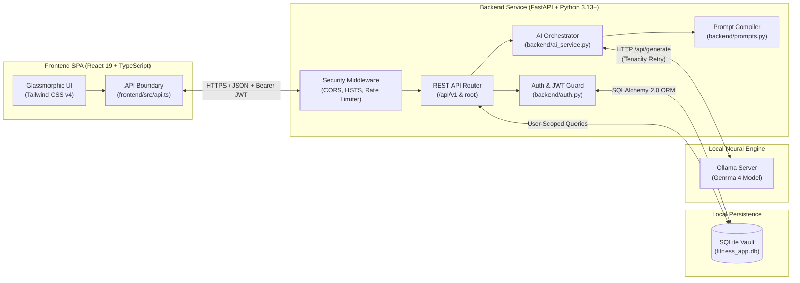

<div align="center">


<br />

# SomaSense

**Closed-Loop Biological Optimization, Smart Inventory & Local AI Guidance Ecosystem**

[](https://fastapi.tiangolo.com/)
[](https://react.dev/)
[](https://www.typescriptlang.org/)
[](https://tailwindcss.com/)
[-D4AF37?style=for-the-badge&logo=ollama&logoColor=black)](https://ollama.com/)
[](https://www.sqlalchemy.org/)

[**Business Value**](#-executive-summary--business-value) •
[**Core Capabilities**](#-core-capabilities) •
[**System Architecture**](#-system-architecture) •
[**Technical Stack**](#-technical-specifications) •
[**Getting Started**](#-getting-started) •
[**API Overview**](#-api-reference)

</div>

---

## 🎯 Executive Summary & Business Value

Modern health and fitness platforms operate in isolated silos: workout trackers ignore nutritional availability, recipe apps ignore physical training load, and cloud-based AI coaches require transmitting sensitive biometric data to third-party servers at recurring API costs.

**SomaSense** solves this fragmentation by unifying **biometric telemetry**, **physical activity tracking**, and **household food inventory** into a single closed-loop platform powered by a **locally hosted Gemma 4 language model** (via Ollama).

### Why SomaSense? (Business & Operational Impact)

| Business Pillar | Challenge Addressed | SomaSense Value Proposition |
| :--- | :--- | :--- |
| **1. Food Waste & Cost Reduction (FEFO)** | Households discard 20–30% of purchased groceries due to poor visibility of expiration dates and uncoordinated meal planning. | **Expiration-Aware Meal Crafting:** Automatically sorts pantry inventory by expiration timestamp (*First Expired, First Out*) and instructs the AI engine to prioritize perishable stock in daily meal protocols. |
| **2. Zero-Cloud Data Sovereignty** | Sensitive health metrics, injuries, and dietary constraints are routinely monetized or exposed via external cloud LLM APIs. | **100% On-Premise AI Inference:** All diet, workout, and supply plans are computed locally through Ollama (`gemma4`). Zero external data leakage and **$0/month recurring token costs**. |
| **3. Automated Supply Chain Sync** | Manually cross-referencing meal plans against existing kitchen stock across multiple storage zones is error-prone and time-consuming. | **Delta-Based Shopping Lists:** Reconciles active training demands and target planning horizons (1–30 days) against live stock, respecting user budgets and dietary exclusions. |
| **4. Adaptive Human Performance** | Static workout PDFs and generic calorie calculators fail to adapt to daily activity burn, equipment limits, or physical injuries. | **Context-Aware Programming:** Synthesizes user biometrics, recent caloric expenditure (last 30 sessions), available equipment, and injury constraints into actionable training regimens. |

### Target Use Cases

- **Privacy-Conscious Athletes & Biohackers:** Self-hosted personal performance hub with full ownership of biometric and nutritional logs.
- **Boutique Fitness Studios & Wellness Clinics:** On-premise client guidance workstation without GDPR/HIPAA cloud LLM compliance overhead.
- **Smart Home & Household Resource Management:** Integrated kitchen inventory tracker with automated consumption deduction and low-stock alerting.

---

## ✨ Core Capabilities

### 🏺 1. Multi-Zone Inventory Vault (Smart Pantry)
- **Sector Tracking:** Organize supplies across **Fridge**, **Pantry**, and **Freezer** storage zones.
- **Granular Quantities & Units:** Track items in grams (`g`), milliliters (`ml`), or discrete pieces (`pcs`) with expiration timestamps.
- **Automated Consumption Engine:** Deducts consumed ingredients directly from active stock (`/items/consume`), automatically flagging shortages, missing items, and low-stock thresholds (`≤ 50g` or `≤ 1 pc`).

### 🧬 2. Biometric Profile & Activity Telemetry
- **Biological Profile:** Persist age, weight, height, gender, primary fitness goal, baseline activity level, and dietary preferences/allergies.
- **Activity Ledger:** Log training sessions with activity type, duration (minutes), caloric burn (`kcal`), and date—automatically feeding the AI nutrition engine.

### 🧠 3. Local Gemma 4 Neural Core
- **AI Nutrition Crafting (`/ai/diet`):** Generates full-day meal protocols (Breakfast, Lunch, Dinner, Snacks) with estimated macro/calorie breakdowns tailored to existing pantry stock and recent caloric burn.
- **AI Program Design (`/ai/workout`):** Builds structured weekly microcycles with warm-up, main sets, reps, rest intervals, and progression guidance adapted to discipline, equipment, focus areas, and injuries.
- **AI Supply Sync (`/ai/shopping`):** Produces categorized shopping lists (`Protein`, `Vegetables`, `Healthy Fats`, `Carbs/Grains`, `Other`) optimized for a custom day range (`1–30` days) and financial budget.
- **Persistent Plan History:** Automatically stores and retrieves the latest generated protocol per category (`diet`, `workout`, `shopping`).

### 🛡️ 4. Enterprise-Grade Security & Access Control
- **Hardened JWT Authentication:** Scoped bearer tokens with issuer (`iss`), audience (`aud`), and unique token ID (`jti`) validation.
- **Server-Side Token Revocation:** Explicit logout blacklists active tokens in the database to prevent replay attacks.
- **Timing-Safe Auth & Rate Limiting:** Protects `/auth/register` and `/auth/token` with `slowapi` rate limiting (`5 req/min`) and dummy-hash verification against user enumeration.

---

## 🏗️ System Architecture



---

## 🔧 Technical Specifications

### Technology Stack

| Layer | Technology | Version / Details | Purpose |
| :--- | :--- | :--- | :--- |
| **Frontend Framework** | React + TypeScript | React `19.2`, TS `~5.9.3` | Reactive Single-Page Application with strict typing |
| **Build & Styling** | Vite + Tailwind CSS | Vite `7.3`, Tailwind `v4.2` | Custom *Ancient Earth + Glassmorphism* design system |
| **UI Components** | Lucide React + Marked | `lucide-react`, `marked` | Vector iconography & sanitized AI Markdown rendering |
| **Backend Framework** | FastAPI + Uvicorn | FastAPI `0.129`, Uvicorn `0.31` | High-performance ASGI REST API with OpenAPI docs |
| **Database & ORM** | SQLite + SQLAlchemy | SQLAlchemy `>=2.0` | Relational persistence with composite indexing |
| **Data Validation** | Pydantic v2 | `pydantic>=2.0`, `pydantic-settings` | Strict schema validation & environment configuration |
| **Security & Crypto** | Passlib + Python-JOSE | `bcrypt`, `cryptography`, `slowapi` | Password hashing, JWT signing, & endpoint rate limiting |
| **AI Inference** | Ollama + Tenacity | Local `gemma4` model | Resilient local LLM inference with exponential backoff |
| **Testing Suite** | Pytest + HTTPX | `pytest>=9.0`, `pytest-asyncio` | Comprehensive unit, integration, and security tests |

### Repository Structure

```text
SomaSens/
├── backend/
│   ├── main.py            # FastAPI application, middleware, and route handlers
│   ├── ai_service.py      # Ollama HTTP client, error handling, and retry logic
│   ├── prompts.py         # Structured prompt builders for diet, workout & shopping
│   ├── models.py          # SQLAlchemy ORM models & Pydantic request/response schemas
│   ├── auth.py            # Bcrypt hashing, JWT creation/validation, token revocation
│   ├── config.py          # Environment settings validation (Pydantic Settings)
│   └── database.py        # SQLite engine setup, session lifecycle, schema indexing
├── frontend/
│   ├── src/
│   │   ├── components/    # Modular UI views (Home, Pantry, Activities, AIAssistant, Profile, Auth, About)
│   │   ├── api.ts         # Centralized fetch wrapper with Bearer token management
│   │   ├── types.ts       # Shared TypeScript interfaces
│   │   ├── App.tsx        # Main layout, navigation, and session state
│   │   └── index.css      # Tailwind v4 theme variables & glassmorphism utilities
│   ├── package.json       # Frontend dependencies and build scripts
│   └── vite.config.ts     # Vite bundler configuration
├── tests/                 # Automated backend test suite (auth, items, AI, profile, security)
├── docs/assets/           # Documentation graphics and visual assets
├── .env.template          # Template for required environment variables
├── requirements.txt       # Python backend dependencies
├── pytest.ini             # Pytest configuration
└── run_app.sh             # Unified orchestration script for local execution
```

---

## 🚀 Getting Started

### 1. Prerequisites

Ensure the following tools are installed on your system:
- **Python** `3.13+`
- **Node.js** `20+` and **npm**
- **[Ollama](https://ollama.com/)** (running locally for AI plan generation)

---

### 2. Installation

#### Clone the Repository
```bash
git clone https://github.com/rafalmadej1/SomaSens.git
cd SomaSens
```

#### Set Up the Backend Virtual Environment
> **Note:** `run_app.sh` expects the Python virtual environment inside the `.venv` directory.

```bash
python3 -m venv .venv
./.venv/bin/pip install --upgrade pip
./.venv/bin/pip install -r requirements.txt
```

#### Install Frontend Dependencies
```bash
npm --prefix frontend install
```

#### Pull the Local Gemma 4 Model via Ollama
Ensure the Ollama daemon is running (`ollama serve`), then download the default model:
```bash
ollama pull gemma4
```

---

### 3. Environment Configuration

Copy the template file to create your local `.env` configuration:
```bash
cp .env.template .env
```

Generate a cryptographically strong `JWT_SECRET_KEY` (minimum 32 characters) and update `.env`:
```bash
python3 -c "import secrets; print(secrets.token_urlsafe(32))"
```

Your `.env` file should contain:
```dotenv
# Local Ollama AI Configuration
OLLAMA_BASE_URL=http://127.0.0.1:11434
OLLAMA_MODEL=gemma4
OLLAMA_TIMEOUT_SECONDS=120

# Security & JWT Configuration (REQUIRED)
JWT_SECRET_KEY=replace-with-your-generated-32-plus-character-secret
JWT_ISSUER=somasense-api
JWT_AUDIENCE=somasense-client

# CORS & Environment
ALLOWED_ORIGINS=http://localhost:5173,http://localhost:3000
ENVIRONMENT=development
```

---

### 4. Launching the Application

#### Option A: Unified One-Command Launch (Recommended)
Use the included orchestration script, which validates `.venv`, checks port availability, installs missing frontend packages, and supervises both servers concurrently:

```bash
chmod +x run_app.sh
./run_app.sh
```

Press `Ctrl+C` at any time to gracefully terminate both Backend and Frontend processes.

#### Option B: Run Services Separately
**Terminal 1 — Backend API (`http://127.0.0.1:8000`):**
```bash
./.venv/bin/uvicorn backend.main:app --reload --port 8000
```

**Terminal 2 — Frontend Dev Server (`http://localhost:5173`):**
```bash
npm --prefix frontend run dev
```

#### Access Points
- **Frontend Web App:** `http://localhost:5173`
- **Interactive Swagger UI (OpenAPI):** `http://127.0.0.1:8000/docs`
- **ReDoc API Reference:** `http://127.0.0.1:8000/redoc`

---

## 🧪 Testing & Quality Assurance

SomaSense includes an automated test suite covering authentication flows, token revocation, inventory consumption edge cases, AI service resilience, API versioning, and security headers.

```bash
# Run the complete backend test suite
./.venv/bin/python -m pytest

# Run a specific test module or test case
./.venv/bin/python -m pytest tests/test_auth.py::test_logout_revokes_access_token

# Run frontend static analysis (ESLint)
npm --prefix frontend run lint

# Verify TypeScript compilation and production bundle build
npm --prefix frontend run build
```

---

## 📡 API Reference

All routes are available at both the root path (`/`) and versioned prefix (`/api/v1`). Protected endpoints require an `Authorization: Bearer <access_token>` header.

| Domain | Method | Endpoint | Description |
| :--- | :---: | :--- | :--- |
| **Auth** | `POST` | `/auth/register` | Register a new user account (`8–72` UTF-8 byte password, rate-limited) |
| **Auth** | `POST` | `/auth/token` | Authenticate via OAuth2 form data and receive a 7-day JWT |
| **Auth** | `POST` | `/auth/logout` | Revoke the current bearer token server-side (`204 No Content`) |
| **Inventory** | `GET` | `/items` | List user pantry items (paginated via `limit` & `offset`) |
| **Inventory** | `POST` | `/items` | Add a new item with quantity, unit, storage sector, and expiry date |
| **Inventory** | `DELETE` | `/items/{item_id}` | Remove an item from the user's inventory vault |
| **Inventory** | `POST` | `/items/consume` | Batch-deduct consumed quantities and return shortage/low-stock warnings |
| **Profile** | `GET` | `/profile` | Retrieve biometric parameters and fitness goals |
| **Profile** | `PUT` | `/profile` | Update age, weight, height, gender, goal, activity level, and diet |
| **Activities** | `GET` | `/activities` | List logged physical activities (paginated via `limit` & `offset`) |
| **Activities** | `POST` | `/activities` | Record a workout session with duration, calories burned, and date |
| **Activities** | `DELETE` | `/activities/{id}` | Delete a specific activity log |
| **AI Core** | `POST` | `/ai/diet` | Generate a personalized daily meal plan from expiring inventory & activity |
| **AI Core** | `POST` | `/ai/workout` | Generate a tailored workout microcycle based on biometrics & equipment |
| **AI Core** | `POST` | `/ai/shopping` | Generate a budget-aware shopping list reconciled against current stock |
| **AI Core** | `GET` | `/ai/last_plan/{type}` | Retrieve the most recently generated `diet`, `workout`, or `shopping` plan |

---

<div align="center">

**SomaSense** — *Designed for the High-Performance Human.*

</div>
